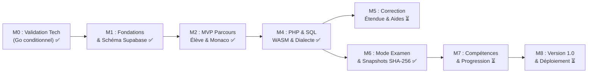
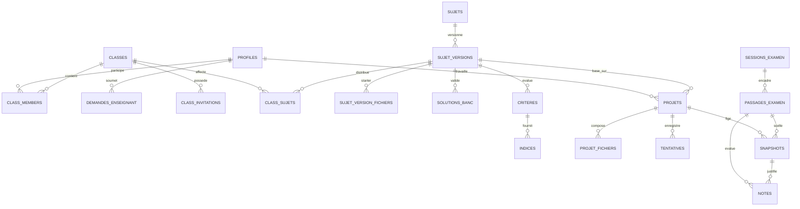

# CONTEXT.md — Labo STI (Plateforme d'Entraînement Bac STI)

> **Source de référence** : PRD v3.1 (18 octobre 2026) disponible dans [`docs/PRD.md`](docs/PRD.md).  
> **Dernière mise à jour du contexte** : 23 octobre 2026 (Alignement post-audit technique, sécurité et pédagogique).

---

## 1. Identité et Vision du Projet

**Labo STI** est une plateforme web d'entraînement et d'examen blanc conçue spécifiquement pour les élèves de **4e année du Baccalauréat Sciences de l'Informatique (STI — Tunisie)** et leurs enseignants.  
Elle combine un **environnement de développement intégré dans le navigateur (type VS Code)** avec un **moteur pédagogique temps réel** :

- **Élève** : code sans installation locale, bénéficie d'une prévisualisation immédiate dans un bac à sable sécurisé, reçoit un feedback instantané critère par critère via le bouton « Vérifier », débloque des indices progressifs (3 niveaux), révise via le hub multimédia `/cours` et s'entraîne dans un mode examen blanc synchronisé par horloge serveur.
- **Enseignant** : conçoit et publie des sujets via le Studio enseignant (`/enseignant/studio`) avec banc didactique à 3 variantes (`canonique`, `alternative`, `invalide`), suit en direct la progression de sa classe, consulte les travaux en lecture seule, accède au catalogue des Modules A, B et C (10 sujets), rejoue la correction de référence sur snapshots certifiés et ajuste les notes officielles avec motivation pédagogique.
- **Administrateur** : valide formellement les demandes d'accès enseignant (`demandes_enseignant`, `profiles.valide_par`) pour prévenir toute usurpation (T-03), gère les rôles applicatifs (`eleve`, `enseignant`, `admin`), surveille la santé des services et pilote la conformité RGPD (anonymisation irréversible T-14).

---

## 2. Principes Directeurs Fondamentaux

1. **Transparence des moteurs d'exécution** : l'exécution locale PHP et SQL repose actuellement sur un **simulateur PHP procédural en Web Worker** (`php-worker-core.ts` / `MySqliSimulator` avec watchdog 3s) et un **moteur relationnel SQLite/MySQLi en mémoire TypeScript** (`sqlite-engine.ts` / `sql-checker.ts`), accompagnés d'un contrôleur de dialecte MySQL/MariaDB (`dialect-controller.ts`).
2. **Parcours complet de bout en bout** : onboarding -> édition Monaco -> arborescence fichiers -> aperçu sandboxé -> tampon IndexedDB résilient -> vérification formative -> sessions d'examen -> scellement cryptographique -> Studio de création de sujets.
3. **Le résultat observable prime sur le code** : les sondes vérifient le rendu final et les effets de bord (DOM calculé, styles CSS, interactions JS par cas `js_test_cas`, sorties PHP, tables et contraintes SQL).
4. **Aucune donnée de confiance côté client** : corrigés types (`solutions`, `solutions_banc`), critères masqués, sessions, clôture d'examen et snapshots sont strictement régis par le serveur (Supabase RLS, triggers SQL et horloge serveur monotone).
5. **Ne jamais perdre le travail d'un élève** : sauvegarde locale en premier (IndexedDB `labo_sti_buffer`), synchronisation en tâche de fond avec numéros de révision (`rev`) et arbitrage explicite en cas de conflit (aucun écrasement silencieux).
6. **L'humain décide** : l'enseignant reste l'unique maître de la note finale et des ajustements ; la correction automatique de référence sur snapshot scellé pré-remplit la grille officielle, mais impose une motivation pédagogique tracée en cas d'ajustement.

---

## 3. Stack Technique et Choix d'Architecture

```
┌───────────────────────────────── Navigateur Client ──────────────────────────────────┐
│                                                                                      │
│   Interface UI type VS Code (TanStack Start / React 19 / Tailwind v4 / Radix UI)     │
│   ├── Arborescence normalisée (Travail_Eleve/SW_xxxxx)                                │
│   ├── Éditeur de code (Monaco Editor avec coloration HTML/CSS/JS/PHP/SQL)            │
│   ├── Panneau latéral : Énoncé Markdown, Indices (3 niveaux), Résultats critères     │
│   ├── Aperçu HTML/CSS/JS (iframe sandbox isolée, sans réseau sortant)                │
│   ├── Simulateur PHP local (Web Worker dédié, Watchdog 3s, MySQLi procédural)        │
│   ├── Base SQL locale (Moteur SQLite/MySQLi TS + Contrôleur de dialecte MySQL)       │
│   ├── Tampon local persistant (IndexedDB labo_sti_buffer) avec arbitrage conflits    │
│   ├── Salle d'attente Realtime & Minuteur asservi à l'horloge serveur                │
│   ├── Moteur de scellement SHA-256 et export officiel SW_xxxxx.zip                   │
│   └── Espaces dédiés : Cours (/cours), Enseignant (/enseignant, Studio) & Admin      │
│                                                                                      │
└──────────────────────────────────────────┬───────────────────────────────────────────┘
                                           │ HTTPS / TLS (API & RLS)
                                           ▼
┌────────────────────────────────────── Backend ───────────────────────────────────────┐
│                                                                                      │
│   Serveur SSR / API (TanStack Start / Nitro / Cloudflare & Vercel Edge)              │
│   └── Synchronisation horloge serveur (obtenir_horloge_serveur), routes typées       │
│                                                                                      │
│   Supabase Cloud / Postgres                                                          │
│   ├── Auth : Authentification e-mail / mot de passe, rôles applicatifs               │
│   ├── Base de données : 30 tables relationnelles, RLS stricte, Triggers d'immuabilité│
│   │   ├── 17 migrations SQL versionnées dans supabase/migrations/ (0000 à 0016+)     │
│   │   ├── Triggers anti-triche : T-06 (échéance), T-07 (machine états), T-08 (snapshot)│
│   │   └── Triggers immuabilité : T-09 (sujet_versions publiées et critères protégés) │
│   ├── Storage S3 : Énoncés, médias, dumps SQL, archives scellées                     │
│   └── Realtime : Événements de sessions d'examen, coup d'envoi et présence           │
│                                                                                      │
└──────────────────────────────────────────────────────────────────────────────────────┘
```

### Détail des Composants Clés

| Composant               | Technologie retenue                                  | Rôle & Contraintes                                                                       |
| ----------------------- | ---------------------------------------------------- | ---------------------------------------------------------------------------------------- |
| **Framework Fullstack** | TanStack Start (React 19, Nitro, Vite)               | Rendu SSR/CSR, routage déclaratif typé (`src/routeTree.gen.ts`), performances maximales  |
| **Styles & Composants** | Tailwind CSS v4 + Radix UI + Lucide                  | UI moderne, responsive (≥ 1024px pour l'éditeur), thèmes sombre/clair                    |
| **Éditeur de code**     | Monaco Editor (`@monaco-editor/react`)               | Coloration syntaxique HTML/CSS/JS/PHP/SQL, minimap, complétion                           |
| **Backend & Base**      | Supabase Postgres + Auth + Storage                   | RLS activée sur 100% des 30 tables, triggers d'intégrité, stockage fichiers              |
| **Migrations SQL**      | `supabase/migrations/` (source unique de vérité)     | 17 migrations versionnées (`0000` à `0016+`), schémas et RPC PostgreSQL                  |
| **Bac à sable Web**     | `iframe sandbox="allow-scripts"`                     | Confinement strict : blocage réseau (T-11), absence de cookies maîtres                   |
| **Moteur PHP local**    | Simulateur PHP procédural en Web Worker              | Isolation Web Worker, watchdog 3 secondes (T-10), support procédural `mysqli_*`          |
| **Moteur SQL local**    | Moteur SQLite/MySQLi en mémoire (`sqlite-engine.ts`) | DDL/DML, chargement scripts `.sql`, visualiseur de tables interactif                     |
| **Contrôleur Dialecte** | `dialect-controller.ts` & `sql-checker.ts`           | Analyse statique alertant sur les syntaxes SQL non portables sur MySQL/MariaDB           |
| **Résilience Offline**  | IndexedDB (`labo_sti_buffer`)                        | Écriture locale instantanée (< 1s), gestion de conflits par numéros de révision (`rev`)  |
| **Horloge Serveur**     | `server-clock.ts`                                    | Élimination de la dérive client (`offsetMs`), calcul insensible à la manipulation locale |
| **Scellement Copies**   | `snapshot-engine.ts`                                 | Empreinte SHA-256 canonique composite, trigger immuable T-08, export ZIP standardisé     |
| **Rejouage Référence**  | `replay-engine.ts`                                   | Correction officielle déterministe rejouée sur le snapshot, grille sur 20 points         |
| **Studio Enseignant**   | `src/routes/enseignant.studio.tsx`                   | Création/édition de sujets, banc didactique 3 variantes, publication immuable            |
| **Espace Admin**        | `src/routes/admin.tsx`                               | Validation enseignants (`demandes_enseignant`), gestion des rôles, audit sécurité, RGPD  |

---

## 4. Feuille de Route et État des Jalons (M0 à M8)



### Synthèse des Jalons

- **Jalon M0 (Phase 0 : Validation Technique)** : **Validé (Go conditionnel)**.
  - Rapport de faisabilité officiel [`docs/PHASE_0_REPORT.md`](docs/PHASE_0_REPORT.md) validé sur poste de référence (4 Go RAM).
  - Écarts documentés et contournables avec contrôleur de dialecte.
- **Jalon M1 (Phase 1 Lot A : Fondations & Données)** : **Validé**.
  - Migrations `0000`, `0001`, `0002` avec RLS, rôles, immuabilité et gestion de classes/invitations.
- **Jalon M2 (Phase 1 Lot B & C : MVP Parcours Élève)** : **Validé**.
  - Authentification Supabase, visite guidée d'onboarding, éditeur Monaco intégré, tampon IndexedDB résilient, vérification formative instantanée.
- **Jalon M4 (Phase 2 : PHP & SQL Local)** : **Validé**.
  - PHP 8.2 WASM en Web Worker avec watchdog 3s, SQLite Engine, visualiseur interactif de base de données, contrôleur de dialecte MySQL, réinitialisation instantanée et export ZIP `SW_xxxxx.zip`.
- **Jalon M5 (Phase 3 : Correction Étendue & Aides)** : **En cours**.
  - Système d'indices progressifs (3 niveaux), gestion des contestations élèves et désactivation enseignant avec recalcul rétroactif.
- **Jalon M6 (Phase 4 : Mode Examen Blanc & Snapshots)** : **Validé**.
  - Sessions d'examen synchronisées, salle d'attente Realtime, horloge serveur stricte, verrouillage automatique post-échéance (T-06, T-07).
  - Scellement cryptographique SHA-256 canonique des copies (T-08).
  - Moteur de rejouage officiel reproductible avec grille sur 20 points, motivation pédagogique obligatoire et journal d'audit.
  - Catalogue étendu des Modules A, B et C (7 sujets complets d'entraînement et annales officielles du Bac STI).
  - Espace d'administration centrale (`/admin`), validation des enseignants (`valide_par`, T-03) et conformité RGPD (§17, T-14).
- **Jalons M7 & M8 (Phase 5 & v1.0)** : Planifiés.

---

## 5. Modèle de Données & Règles d'Immuabilité

Le schéma Supabase Postgres repose sur **30 tables relationnelles** réparties en 6 domaines métier (définies dans l'unique source de vérité `supabase/migrations/`) :



### Migrations Déployées (`supabase/migrations/`)

- `0000_etape1_profiles_roles.sql` : Table `profiles`, enum `app_role`, table `user_roles`, trigger `handle_new_user`, validation enseignant (`valide_par`).
- `0001_etape2_sujets.sql` : Tables `sujets`, `sujet_versions`, `sujet_version_fichiers`, `criteres`, `solutions`, `indices`, `indices_debloques`, triggers d'immuabilité `protect_published_version` et `protect_published_children`.
- `0002_etape3_classes_projets.sql` : Tables `classes`, `class_invitations`, `class_members`, `class_sujets`, `projets`, `projet_fichiers`, `tentatives`, RPC `rejoindre_classe` et `initialiser_projet`.
- `0003_etape4_sessions_examen.sql` : Tables `sessions_examen`, `passages_examen`, triggers `verifier_echeance_ecriture` (T-06) et `verifier_transition_passage_examen` (T-07), RPC `lancer_coup_denvoi_examen`, fonction `obtenir_horloge_serveur`.
- `0004_etape4_snapshots_rejouage.sql` : Table `snapshots` immuable avec trigger `interdire_mutation_snapshot` (T-08), table `notes`, RPC `sceller_snapshot_examen`.
- `0005_etape3_contestations_solutions.sql` : Tables `journal_securite`, `contestations`, `journal_acces_solutions` et RPC associées.
- `0006_etape5_competences_maitrise.sql` : Tables `competences`, `critere_competences`, `maitrise`, `badges_definition`, `badges`.
- `0007` à `0013` : Correction de récursion RLS, révocation des `GRANT` par défaut, administration des utilisateurs, `demandes_enseignant`, libellés de critères, état système admin et écriture contrôlée dans `journal_securite`.
- `0014_studio_sujets.sql` & `0015_studio_publication.sql` : Table `solutions_banc` et RPC du Studio enseignant (`studio_lister_sujets`, `studio_charger_version`, `studio_enregistrer_brouillon`, `studio_publier_version`, `studio_nouvelle_version`, `sujet_publie_pour_eleve`).
- `0016_restreindre_has_role.sql` : Révocation de `EXECUTE` sur `public.has_role` pour `PUBLIC` et `anon` et restriction de l'inspection des rôles d'un tiers aux seuls administrateurs.

### Règles d'Immuabilité Pédagogique

1. **`sujet_versions` est strictement immuable** : dès qu'une version est publiée (`publiee = true`), aucun `UPDATE` ni `DELETE` n'est autorisé. Toute correction impose la création d'une nouvelle version (`numero + 1`).
2. **Protection des entités filles publiées** : interdiction d'altérer les critères, fichiers starters, solutions et indices d'une version publiée.
3. **Snapshots immuables (T-08)** : toute tentative de modification ou de suppression sur la table `snapshots` est rejetée avec levée d'exception Postgres.
4. **Scellement par horloge serveur (T-06)** : toute tentative d'écriture ou de soumission d'élève après `echeance_serveur` est bloquée par trigger base.
5. **Machine à états stricte (T-07)** : interdiction formelle de repasser un examen rendu (`rendu` ou `corrige`) à l'état `en_cours`.

---

## 6. Sécurité, RLS et Matrice des 14 Tests Négatifs (T-01 à T-14)

L'intégralité des 14 tests négatifs obligatoires définis dans [`docs/SECURITY.md`](docs/SECURITY.md) est automatisée et validée en CI (`src/test/security-negative-harness.test.ts`) :

| Code     | Intitulé & Description Technique                                                                                 | Niveau   | Mécanisme de Vérification                                                                 |   Statut CI   |
| -------- | ---------------------------------------------------------------------------------------------------------------- | -------- | ----------------------------------------------------------------------------------------- | :-----------: |
| **T-01** | **Isolation inter-élèves** : Rejet de la lecture/écriture sur les projets, fichiers et tentatives d'un tiers.    | Bloquant | RLS Postgres `auth.uid() = eleve_id`                                                      | **PASSED** ✅ |
| **T-02** | **Isolation inter-enseignants** : Rejet de l'accès aux classes et copies d'un autre professeur.                  | Bloquant | RLS Postgres `classes.enseignant_id = auth.uid()`                                         | **PASSED** ✅ |
| **T-03** | **Interdiction d'auto-attribution de rôle** : Écrasement systématique de tout rôle non autorisé à l'inscription. | Bloquant | Trigger `handle_new_user` forçant `'eleve'`, validation admin requise pour `'enseignant'` | **PASSED** ✅ |
| **T-04** | **Confidentialité des corrigés** : Absence de `GRANT` client sur la table `solutions` et critères masqués.       | Bloquant | Permission Postgres refusée côté client (`permission denied`)                             | **PASSED** ✅ |
| **T-05** | **Rejet des invitations invalides** : Blocage des codes expirés, révoqués ou quota dépassé + rate-limiting.      | Majeur   | Rate-limiter (5 tentatives max / 15 min) et vérification d'échéance                       | **PASSED** ✅ |
| **T-06** | **Refus d'écriture après échéance** : Rejet des modifications de fichiers après l'heure serveur.                 | Bloquant | Trigger Postgres `verifier_echeance_ecriture` comparant à `clock_timestamp()`             | **PASSED** ✅ |
| **T-07** | **Transitions d'états d'examen invalides** : Rejet de la réouverture d'un examen remis.                          | Bloquant | Trigger Postgres `verifier_transition_passage_examen` bloquant `rendu -> en_cours`        | **PASSED** ✅ |
| **T-08** | **Immuabilité des snapshots** : Rejet formel de toute modification (`UPDATE`) ou suppression (`DELETE`).         | Bloquant | Trigger Postgres `interdire_mutation_snapshot` (`Snapshot immuable`)                      | **PASSED** ✅ |
| **T-09** | **Immuabilité des versions publiées** : Rejet de modification sur une version publiée de sujet.                  | Bloquant | Triggers Postgres `protect_published_version` & `protect_published_children`              | **PASSED** ✅ |
| **T-10** | **Confinement des ressources code élève** : Neutralisation des boucles infinies et fuites mémoire.               | Bloquant | Watchdog 3s (Web Worker & Sandbox) et limite mémoire 64 Mo                                | **PASSED** ✅ |
| **T-11** | **Confinement réseau du bac à sable** : Blocage total des requêtes sortantes et lecture de cookies.              | Bloquant | Sandbox `allow-scripts` sans `allow-same-origin`, CSP stricte, neutralisation API réseau  | **PASSED** ✅ |
| **T-12** | **Absence de secrets dans le client** : Scanner statique vérifiant l'absence de `service_role` ou clés privées.  | Bloquant | Scanner de secrets automatique sur le bundle produit par le build                         | **PASSED** ✅ |
| **T-13** | **Absence de PII dans la télémétrie** : Élimination des identifiants et code élève des logs d'erreurs.           | Majeur   | Sanitizer de télémétrie filtrant les emails, CIN, mots de passe et données personnelles   | **PASSED** ✅ |
| **T-14** | **Conformité RGPD droit à l'effacement** : Anonymisation irréversible des comptes élèves.                        | Majeur   | Procédure d'anonymisation pseudonymisant les profils et purgeant les traces               | **PASSED** ✅ |

---

## 7. Sauvegarde, Tampon Local et Gestion Hors Ligne

- **Tampon Local First (IndexedDB)** : Sauvegarde instantanée dans la base `labo_sti_buffer` (`src/lib/storage/indexeddb.ts`).
- **Synchronisation avec Révisions (`rev`)** : Synchronisation asynchrone avec détection des conflits (`useBufferSync.ts`).
- **Résolution Explicite des Conflits** : Modale interactive (`ConflictModal.tsx`) proposant l'arbitrage : conserver la version locale, adopter la version distante ou créer une copie de sauvegarde. **Aucun écrasement silencieux**.
- **Indicateur Temps Réel** : Barre d'état visuelle (`SyncStatusBar.tsx`) indiquant : _Enregistré localement_, _Synchronisation en cours_, _Synchronisé_ ou _Hors ligne_.

---

## 8. État d'Avancement Réel du Dépôt (Vérifié au 23/10/2026)

| Domaine / Composant                         | État Réel d'Implémentation                                                                                                                                                                                                            | Couverture & Validation                                                           |
| ------------------------------------------- | ------------------------------------------------------------------------------------------------------------------------------------------------------------------------------------------------------------------------------------- | --------------------------------------------------------------------------------- |
| **Base de Données & RLS**                   | 30 tables relationnelles, 17 migrations SQL (`0000` à `0016`) dans `supabase/migrations/`, RLS sur toutes les tables, triggers immuabilité et anti-triche.                                                                            | Déployable sur Supabase, durcissement Horizon 1 en cours (#113–#119).             |
| **Éditeur de Code**                         | Monaco Editor intégré, coloration syntaxique multi-langages, arborescence VS Code normalisée `Travail_Eleve/SW_<NCIN>`.                                                                                                               | Validé sur écrans ≥ 1024px (mode lecture mobile prévu en #135).                   |
| **Runtimes & Moteurs**                      | Simulateur PHP procédural en Web Worker avec watchdog 3s (`php-worker-core.ts`, `MySqliSimulator`), moteur SQLite/MySQLi TS (`sqlite-engine.ts`) avec visualiseur interactif et contrôleur de dialecte MySQL/MariaDB.                 | Unification et extension SQL prévues en #125 et #126.                             |
| **Pédagogie & Résilience Élève (Jalon M5)** | Interface de contestation élève (`ContestationModal`), historique des tentatives avec deltas didactiques (`AttemptsTimelineDrawer`), déblocage tracé des corrigés (`ReferenceSolutionModal`) et garde-fou strict T-04/T-06 en examen. | Tests dédiés validés, neutralisation et recalcul de classe en direct.             |
| **Compétences & Progression (Jalon M7)**    | Référentiel officiel de 25 compétences Bac STI, calcul déterministe de maîtrise v1.0, 8 badges pédagogiques, radar 5 axes et modale interactive `ProgressionModal`.                                                                   | Tests dédiés validés, points forts et axes prioritaires calculés automatiquement. |
| **Mode Examen**                             | Salle d'attente Realtime, coup d'envoi simultané, tiers-temps (1.33x), minuteur asservi à l'horloge serveur, coupure des aides.                                                                                                       | Verrouillage T-06 et transitions T-07 validés.                                    |
| **Snapshots & Rejouage**                    | Scellement cryptographique SHA-256 canonique, trigger T-08, rejouage de référence reproductible, grille sur 20 points avec motivation obligatoire.                                                                                    | Rejouabilité déterministe certifiée.                                              |
| **Catalogue de Contenu & Cours**            | 10 sujets complets intégrés dans `content/` (Modules A, B et C dont Bac 2021, 2022, 2023, 2025, 2026) + Hub interactif `/cours` (10 capsules vidéo, flashcards, quiz et tuteur IA du carnet STI-BAC INFO).                            | Solutions canoniques et critères testés automatiquement.                          |
| **Espaces Dédiés**                          | Espace Élève (`/`, `/sujet/$id`, `/cours`), Espace Enseignant (`/enseignant`, `/enseignant/studio`), Espace Admin (`/admin`).                                                                                                         | Routes typées TanStack Router, Mode Démo interactif.                              |
| **Suite de Tests CI**                       | Plus de **440 tests automatisés** au vert (`vitest run`), formatage Prettier, lint ESLint (`--max-warnings=0`) et typage strict TypeScript (`tsc --noEmit`) à 0 erreur.                                                               | CI GitHub Actions bloquante avant déploiement Vercel.                             |
| **Build & Déploiement**                     | Build de production réussi (Client Vite + SSR Nitro / Cloudflare & Vercel Edge).                                                                                                                                                      | Déployable en production.                                                         |

---

## 9. Décisions Ouvertes et Réponses Cadrées (Q1 à Q9)

- **Q1 (Environnement de référence)** : PHP 8.2 WASM + SQLite relationnel local avec contrôleur de dialecte MySQL/MariaDB (standard officiel Bac STI).
- **Q2 (Volumétrie)** : Validé pour ~35 élèves simultanés par classe et jusqu'à 300 élèves par établissement lors d'épreuves groupées.
- **Q3 (Données de mineurs & RGPD)** : Minimisation stricte des données (nom, prénom, classe), pas de profilage, outil d'anonymisation irréversible (T-14).
- **Q4 (Comportement réseau)** : Tampon IndexedDB obligatoire, minuteur basé sur `echeance_serveur`, tolérance aux micro-coupures réseau.
- **Q5 (Licences)** : MIT (code) + CC BY-SA 4.0 (contenus pédagogiques). Dépendances WASM conformes.
- **Q6-Q9 (Phases 2 & 4)** : Faisabilité WASM validée (Go conditionnel), dialecte MySQL contrôlé, snapshots scellés par SHA-256 avec reproductibilité déterministe certifiée.
