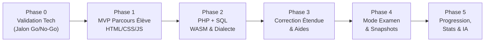
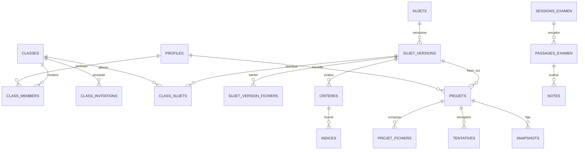

# CONTEXT.md — Labo STI (Plateforme d'Entraînement Bac STI)

> **Source de référence** : PRD v3.1 (18 octobre 2026) disponible dans [`docs/PRD.md`](file:///d:/My%20Projects/lab-analysis/app-creator/docs/PRD.md).  
> **Dernière mise à jour du contexte** : 18 octobre 2026.

---

## 1. Identité et Vision du Projet

**Labo STI** est une plateforme web d'entraînement et d'examen blanc conçue spécifiquement pour les élèves de **Bac STI** (filière STI2D / NSI / systèmes numériques) et leurs enseignants.  
Elle combine un **environnement de développement intégré dans le navigateur (type VS Code)** avec un **moteur pédagogique temps réel** :

- **Élève** : code sans installation locale, bénéficie d'une prévisualisation immédiate, reçoit un feedback instantané critère par critère via le bouton « Vérifier », débloque des indices progressifs et s'entraîne dans un mode examen blanc chronométré.
- **Enseignant** : publie des sujets rigoureusement testés et versionnés de manière immuable, suit en direct la progression de sa classe, consulte les travaux en lecture seule, corrige avec une grille pré-remplie et exporte les résultats.
- **Administrateur** : valide les comptes enseignants pour éviter toute usurpation et supervise la conformité RGPD.

---

## 2. Principes Directeurs Fondamentaux

1. **Valider avant d'élargir** : l'exécution client PHP WASM + SQLite WASM est un jalon de décision (Phase 0). Si un scénario essentiel échoue, bascule automatique sur le **Plan B** (conteneurs éphémères isolés).
2. **Parcours complet avant modules** : privilégier un parcours utilisateur de bout en bout (onboarding -> édition -> aperçu -> vérification -> persistance) plutôt qu'un empilement de fonctionnalités partielles.
3. **Le résultat observable prime sur le code** : les tests vérifient le rendu final et les effets de bord (DOM calculé, sorties HTTP, état de la base), jamais une syntaxe de code imposée.
4. **Aucune donnée de confiance côté client** : corrigés types, critères masqués, sessions et minuteurs d'examen sont strictement gérés et validés côté serveur (Supabase RLS & Nitro API).
5. **Ne jamais perdre le travail d'un élève** : sauvegarde locale en premier (IndexedDB), synchronisation distante en tâche de fond avec gestion des révisions (`rev`) et résolution explicite de conflits.
6. **L'humain décide** : l'enseignant reste l'unique maître de la note finale et des sanctions disciplinaires ; la pré-correction et les métriques de triche ne sont que des indicateurs d'aide.

---

## 3. Stack Technique et Choix d'Architecture

```
┌───────────────────────────────── Navigateur Client ──────────────────────────────────┐
│                                                                                      │
│   Interface UI type VS Code (TanStack Start / React 19 / Tailwind v4 / Radix UI)     │
│   ├── Arborescence normalisée (Travail_Eleve/SW_xxxxx)                                │
│   ├── Éditeur de code (Monaco Editor avec coloration syntaxique HTML/CSS/JS/PHP/SQL) │
│   ├── Panneau latéral : Énoncé Markdown, Indices (3 niveaux), Résultats critères     │
│   ├── Aperçu HTML/CSS/JS (iframe sandbox isolée, sans réseau sortant)                │
│   ├── Exécution PHP locale (Web Worker PHP WASM - Phase 2)                           │
│   ├── Base de données SQL locale (SQLite WASM + Contrôleur de dialecte MySQL)        │
│   └── Tampon local persistant (IndexedDB) + Cache SW (WASM & assets)                 │
│                                                                                      │
└──────────────────────────────────────────┬───────────────────────────────────────────┘
                                           │ HTTPS / TLS (API & RLS)
                                           ▼
┌────────────────────────────────────── Backend ───────────────────────────────────────┐
│                                                                                      │
│   Serveur SSR / API (TanStack Start / Nitro / Vercel Edge)                           │
│   └── Routes sécurisées : calcul temps examen, déblocage d'indices, validation       │
│                                                                                      │
│   Supabase Cloud / Postgres                                                          │
│   ├── Auth : Authentification e-mail / mot de passe, rôles applicatifs               │
│   ├── Base de données : 26 tables relationnelles, RLS stricte, Triggers d'immuabilité│
│   ├── Storage S3 : Énoncés, ressources médias, dumps SQL, archives de projets        │
│   └── Realtime : Événements de sessions d'examen en direct                           │
│                                                                                      │
└──────────────────────────────────────────────────────────────────────────────────────┘
```

### Détail des Composants Clés

| Composant | Technologie retenue | Rôle & Contraintes |
|---|---|---|
| **Framework Fullstack** | TanStack Start (React 19, Nitro, Vite) | Rendu SSR/CSR, routage déclaratif typé, performances maximales |
| **Styles & Composants** | Tailwind CSS v4 + Radix UI + Lucide | UI moderne, responsive (≥ 1024px pour l'éditeur), thèmes clair/sombre |
| **Éditeur de code** | Monaco Editor | Coloration syntaxique HTML/CSS/JS/PHP/SQL, complétion, raccourcis VS Code |
| **Backend & Base** | Supabase Postgres + Auth + Storage | RLS activée sur 100% des tables, triggers d'intégrité, stockage fichiers |
| **ORM & Migrations** | Drizzle ORM + Supabase Migrations | Schémas typés TypeScript, migrations SQL versionnées et auditables |
| **Bac à sable Web** | `iframe sandbox="allow-scripts"` | Isolation totale : blocage de fetch/XHR externe, des cookies maîtres et de l'accès parent |
| **Moteur PHP local** | PHP WASM (Web Worker) | Émulation de PHP 8.2 dans un thread séparé avec timeout et limite mémoire |
| **Moteur SQL local** | SQLite WASM | Base de données locale pour l'élève avec lint/vérificateur de dialecte MySQL strict |
| **Résilience Offline** | IndexedDB + Service Worker | Écriture locale instantanée (< 1s), file d'attente de sync distante avec numéros de révision |

---

## 4. Feuille de Route et Critères de Sortie par Phase



### Jalon Décisif : Phase 0 (Validation Technique)
- **Objectif** : Prouver la faisabilité et la fidélité de PHP WASM + SQLite sur 3 sujets réels du Bac STI (S1 : Formulaire PHP POST + insertion, S2 : SQL avancé avec jointures et agrégats, S3 : CRUD multi-pages sessions).
- **Règle de décision** :
  - **Go** : 100 % des scénarios essentiels réussis, ≥ 90 % des secondaires, perf acceptable sur machine 4 Go RAM.
  - **Go conditionnel** : Écarts documentés et contournables avec avertissements clairs.
  - **No-Go** : Échec d'un scénario essentiel -> Déclenchement du **Plan B** (conteneurs isolés côté serveur).

### Phase 1 : MVP — Parcours Élève Complet HTML/CSS/JS
- Authentification Supabase, Rôles (`eleve`, `enseignant`, `admin`).
- Classes avec codes d'invitation (expiration, révocation, limite d'usages).
- Publication versionnée immuable des sujets (`sujet_versions`).
- Onboarding guidé lors du premier accès.
- Espace de travail : arborescence normalisée, import d'images/ressources, aperçu temps réel.
- Tampon local (IndexedDB) avec reprise après coupure réseau.
- Vérification automatique formative (DOM/CSS/JS simples) avec score et messages d'erreur.
- Suite de tests négatifs T-01 à T-14 au vert sur le périmètre MVP.

### Phase 2 : PHP + SQL Local
- Panneau Base de données (tables, structure, éditeur de requêtes).
- Connexion PHP via `mysqli`/PDO dans le bac à sable.
- Contrôleur de dialecte SQL (signalement des syntaxes SQLite incompatibles MySQL).
- Réinitialisation propre à l'état initial de la version du sujet.
- Export et import de dumps `.sql` et archives `SW_xxxxx.zip`.

### Phase 3 : Correction Automatique Étendue & Aides
- Modèles de tests avancés multi-langages (actions DOM, entrées/sorties PHP, assertions SQL).
- Indices progressifs sur 3 niveaux avec déblocage sécurisé côté serveur.
- Déblocage tracé des corrigés de référence.
- Mécanisme de contestation par l'élève, désactivation de critère par l'enseignant et recalcul rétroactif.

### Phase 4 : Mode Examen Blanc & Snapshots
- Sessions synchronisées avec salle d'attente et minuteur côté serveur.
- Verrouillage automatique : écritures refusées côté serveur à l'échéance.
- Création de **snapshots immuables** (fichiers + dump base + versions moteur/critères).
- Reproductibilité stricte de la correction de référence.
- Grille de correction assistée pour l'enseignant avec journalisation des ajustements.

### Phase 5 : Progression, Pilotage & Tuteur Optionnel
- Référentiel de compétences du programme STI.
- Formule de maîtrise transparente et détection des points faibles.
- Statistiques de classe et indicateurs de blocage.
- Tuteur IA pédagogique (sans révélation de la solution, strictement désactivé en examen).

---

## 5. Modèle de Données & Règles d'Immuabilité

Le modèle de données repose sur **26 tables relationnelles** dans Postgres (schéma `public`), régies par des règles d'intégrité strictes :



### Règles d'Immuabilité Pédagogique
1. **`sujet_versions` est immuable** : dès qu'une version est publiée (`publiee = true`), aucun `UPDATE` ni `DELETE` n'est autorisé. Toute correction d'énoncé ou de critère nécessite l'incrémentation du numéro de version (`numero + 1`).
2. **Les enfants de versions publiées sont protégés** : triggers Postgres bloquant toute modification sur `sujet_version_fichiers`, `criteres`, `solutions` et `indices` rattachés à une version publiée.
3. **Snapshots immuables** : un snapshot d'examen consigne le hash, les fichiers exacts, la version du sujet et l'état de la base. Il ne peut être ni altéré ni supprimé.
4. **Désactivation logique des critères** : un critère contesté passe à `actif = false`, permettant de recalculer les notes sans corrompre les historiques de tentatives.

---

## 6. Sécurité, RLS et Matrice des Tests Négatifs (T-01 à T-14)

Chaque règle de sécurité est validée par un test négatif automatisé en CI :

| Code | Intitulé du Test Négatif | Règle d'Acceptation | Statut |
|---|---|---|---|
| **T-01** | Isolation inter-élèves | Élève A ne peut ni lire ni modifier les projets, fichiers, tentatives d'Élève B | À automatiser (MVP) |
| **T-02** | Isolation inter-enseignants | Enseignant A ne peut pas accéder aux classes ou résultats d'Enseignant B | À automatiser (MVP) |
| **T-03** | Répudiation de privilèges | Un élève ne peut pas s'auto-attribuer le rôle `enseignant` ou `admin` | Validé en migration 0000 |
| **T-04** | Confidentialité des corrigés | `solutions` et critères masqués n'ont aucun `GRANT` client et sont illisibles | Validé en migration 0001 |
| **T-05** | Validité des invitations | Code expiré, révoqué ou quota atteint = refusé ; protection anti-bruteforce | À automatiser (MVP) |
| **T-06** | Horloge serveur d'examen | Écriture refusée après `echeance_serveur`, indépendamment de l'horloge locale | Phase 4 |
| **T-07** | Machine à états d'examen | Transitions illégales de statut de passage d'examen rejetées | Phase 4 |
| **T-08** | Intégrité des snapshots | Tentative de modification d'un snapshot rendu rejetée par trigger Postgres | Phase 4 |
| **T-09** | Immuabilité des versions | `UPDATE`/`DELETE` sur `sujet_versions` publiée bloqué par trigger | Validé en migration 0001 |
| **T-10** | Dépassement de ressources | Boucle infinie / fuite mémoire dans code élève interceptée par timeout sandbox | Phase 1 & 2 |
| **T-11** | Confinement réseau | Iframe sandbox sans `allow-same-origin` vers domaine app et sans accès réseau | Phase 1 |
| **T-12** | Zéro secret client | `service_role` et clés secrètes absentes du bundle Vite et des logs client | Strict en CI |
| **T-13** | Télémétrie respectueuse | Pas de code élève ni de données nominatives dans les logs d'erreurs | Conforme Lovable/Sentry |
| **T-14** | Droit à l'oubli RGPD | Suppression de compte = anonymisation/purge complète des données liées | Phase 1 |

---

## 7. Sauvegarde, Tampon Local et Gestion Hors Ligne

Pour respecter le principe directeur **« Ne jamais perdre le travail d'un élève »** :

1. **Tampon Local First (IndexedDB)** :
   - Chaque frappe ou modification de fichier est enregistrée immédiatement en local dans la base IndexedDB du navigateur (`labo_sti_buffer`).
   - L'interface affiche l'indicateur d'état en temps réel : `Enregistré localement` / `Synchronisation en cours` / `Synchronisé avec le serveur` / `Hors ligne`.
2. **Synchronisation avec Révisions (`rev`)** :
   - Chaque document porte un incrément entier de révision `rev`.
   - Si le serveur possède un `rev` supérieur à la base locale lors de la synchronisation (ex. travail ouvert sur deux postes ou deux onglets), l'application propose un écran de conciliation : **Garder ma version locale**, **Prendre la version serveur** ou **Créer une copie de sauvegarde**. Aucun écrasement silencieux n'est permis.
3. **Résilience Examen & Coupures Réseau** :
   - L'horloge officielle est régie par le serveur, mais l'élève peut continuer de coder en local en cas de micro-coupure réseau.
   - Les modifications locales horodatées avant l'échéance serveur et envoyées dans un délai de grâce (défini à quelques minutes) sont acceptées et annotées « synchronisation tardive » pour l'enseignant.

---

## 8. État d'Avancement Réel du Dépôt (Audit au 18/10/2026)

| Périmètre | Existant dans le code | Écart par rapport au PRD v3.1 | Priorité |
|---|---|---|---|
| **Base de Données** | Migrations `0000` (profiles, user_roles) et `0001` (sujets, versions immuables, critères, indices, solutions) écrites. | Manque les tables `classes`, `class_invitations`, `projets`, `projet_fichiers`, `tentatives`, `snapshots`. | P1 (MVP) |
| **Frontend UI** | Interface minimale `src/routes/sujet.$id.tsx` avec 3 colonnes et simple textarea. | Remplacer le `textarea` par Monaco Editor, intégrer l'arborescence VS Code, l'onboarding et l'import de médias. | P1 (MVP) |
| **Stockage & Sync** | Sauvegarde naïve dans `localStorage` (`src/lib/progress.ts`). | Migrer vers IndexedDB avec tampon de sync et résolution des conflits de révision. | P1 (MVP) |
| **Moteur de Tests** | Évaluateur DOM simple codé en dur (`src/lib/exercises.ts`). | Connecter l'évaluation aux définitions JSON de la table `criteres` stockée en base. | P1 (MVP) |
| **Sécurité** | RLS partielle sur profiles/sujets. | Formaliser la matrice de permissions et implémenter la suite de tests négatifs T-01 à T-14. | P1 (MVP) |
| **Environnement dev** | `package.json` configuré avec Vitest et TanStack Start. | `node_modules` non installés localement ; suite de tests automatisée à lancer. | Immédiat |

---

## 9. Décisions Ouvertes et Réponses Cadrées (Q1 à Q9)

- **Q1 (Environnement de référence)** : PHP 8.2, MariaDB 10.11, extensions `mysqli`, `pdo_mysql`, `mbstring`.
- **Q2 (Volumétrie)** : ~35 élèves simultanés par classe, jusqu'à 300 élèves par établissement lors d'épreuves blanches groupées.
- **Q3 (Données de mineurs & RGPD)** : Minimisation stricte des données (nom, prénom, classe), pas de profilage commercial, serveurs situés dans l'UE, convention avec l'établissement.
- **Q4 (Comportement réseau)** : Tampon IndexedDB obligatoire, délai de grâce de reconnexion pour les examens.
- **Q5 (Licences WASM)** : Vérification de la compatibilité des runtimes PHP WASM (licence PHP / MIT / BSD) avant toute intégration en production.
- **Q6-Q9 (Phases 2 & 4)** : Règle Go/No-Go pour le passage au plan B, standardisation du lint MySQL, reproductibilité des snapshots.
