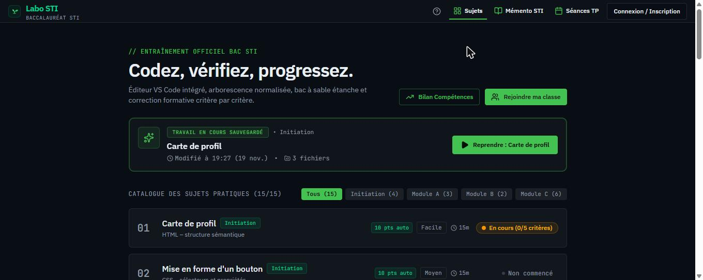
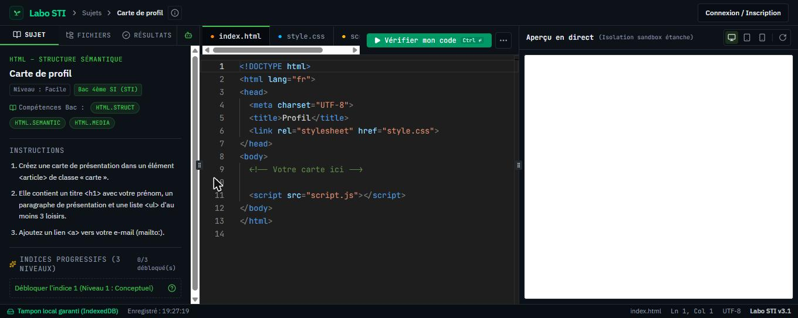
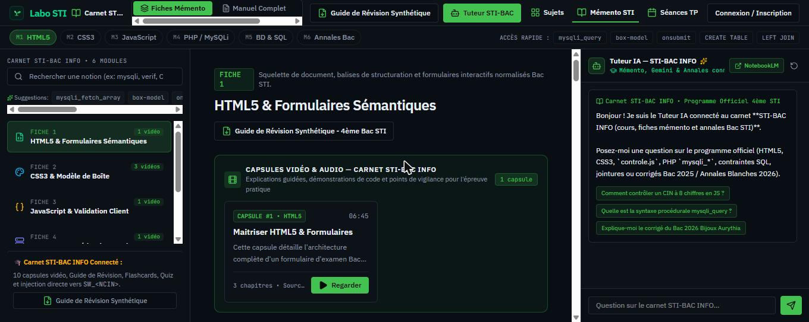

# Labo STI — S'entraîner au Bac Informatique (Tunisie), gratuitement, dans le navigateur

> Plateforme **gratuite** d'entraînement à l'épreuve pratique et à l'épreuve écrite du **Bac Sciences de l'Informatique (STI)** : HTML, CSS, JavaScript, PHP et SQL, avec **correction automatique** critère par critère. Rien à installer.

### 👉 [Ouvrir Labo STI : app-creator-phi.vercel.app](https://app-creator-phi.vercel.app/)

[](https://app-creator-phi.vercel.app/)
[](https://app-creator-phi.vercel.app/)
[](LICENSE)



---

## 🎓 Pour qui ?

| Vous êtes…                                   | Labo STI vous permet de…                                                                                                                                                                                        |
| -------------------------------------------- | --------------------------------------------------------------------------------------------------------------------------------------------------------------------------------------------------------------- |
| **Élève de 4ème Sciences de l'Informatique** | Coder les sujets du Bac directement dans le navigateur, savoir immédiatement ce qui est juste et ce qui manque, débloquer des indices sans recevoir la solution, et refaire les annales en conditions d'examen. |
| **Enseignant d'informatique**                | Créer une classe, inviter vos élèves avec un code, suivre leur progression en direct, consulter leurs travaux et organiser des examens blancs chronométrés.                                                     |

**Aucune installation** : pas besoin de serveur Apache, de PHP ni de MySQL sur les postes du lycée ou à la maison. Un navigateur récent (Chrome, Firefox, Edge) suffit.

---

## 🚀 Commencer en 1 minute

### Élève

1. Ouvrez **[app-creator-phi.vercel.app](https://app-creator-phi.vercel.app/)**.
2. Choisissez un sujet dans le catalogue (Initiation, Module A, B ou C). **Pas besoin de compte pour essayer.**
3. Codez, puis cliquez sur **« Vérifier mon code »** (ou `Ctrl + Entrée`) : chaque critère s'affiche en vert ou en rouge avec une explication.
4. Bloqué ? Débloquez un **indice** (3 niveaux, du rappel de notion à l'exemple de syntaxe).
5. Créez un compte (**Connexion / Inscription**) pour garder votre progression sur tous vos appareils et **rejoindre la classe** de votre enseignant avec son code.

Votre travail est sauvegardé automatiquement, même si la connexion internet coupe.

### Enseignant

1. Créez un compte, puis demandez l'accès enseignant depuis votre profil (validé par l'administrateur).
2. Dans l'**Espace Enseignant**, créez une classe et partagez le **code d'invitation** à vos élèves.
3. Affectez des sujets, suivez la progression de la classe, consultez les copies et lancez des **examens blancs** synchronisés.

---

## ⚡ Ce que contient Labo STI



- **15 sujets pratiques corrigés automatiquement** : initiation HTML/CSS/JS, modules A (client), B et C (PHP/MySQL), et annales du Bac pratique (2018, 2022, 2023, 2025, 2026).
- **10 épreuves écrites** : Bac 2022 à 2025 (sessions principale et de contrôle) et Bac Blanc 2022 à 2024, avec barème et correction.
- **Éditeur type VS Code** (Monaco) avec coloration HTML, CSS, JS, PHP et SQL, et **aperçu en direct**.
- **PHP et SQL dans le navigateur** : `mysqli_*` procédural et base de données relationnelle, avec un avertissement si une syntaxe n'est pas compatible MySQL.
- **Correction formative** critère par critère et **indices progressifs**.
- **Mode examen** : chronomètre serveur, tiers-temps, remise au format officiel `SW_<numéro>`.
- **Mémento STI** (`/cours`) : fiches de cours, capsules vidéo, quiz et un **tuteur** qui répond aux questions sur le programme.
- **Bilan de compétences** : progression sur les compétences du programme officiel et badges.



---

## 🤝 Faire connaître et contribuer

Labo STI est un projet **gratuit et ouvert**, offert aux élèves et enseignants du Bac Informatique.

- ⭐ **Mettez une étoile au dépôt** : cela aide d'autres enseignants à le trouver.
- 📣 **Partagez le lien** [app-creator-phi.vercel.app](https://app-creator-phi.vercel.app/) avec vos élèves, collègues et groupes de révision.
- 🐛 **Signalez un problème ou proposez un sujet** : [ouvrir une issue](https://github.com/hlaadhari/app-creator/issues/new).
- 🧑‍💻 **Contribuez au code ou aux sujets** : voir [`CONTRIBUTING.md`](CONTRIBUTING.md) et le [guide de rédaction des critères](docs/CRITERIA_GUIDE.md).

---

## 🛠 Pour les développeurs

### Stack technique

- **Frontend** : [TanStack Start](https://tanstack.com/start) (React 19, Vite, Nitro), [Tailwind CSS v4](https://tailwindcss.com), [Radix UI](https://www.radix-ui.com/), [Monaco Editor](https://microsoft.github.io/monaco-editor/).
- **Backend & données** : [Supabase](https://supabase.com) (PostgreSQL avec Row Level Security, Auth, Storage, Realtime).
- **Migrations SQL** : `supabase/migrations/` (source unique de vérité SQL).
- **Tests** : [Vitest](https://vitest.dev/), Testing Library, Playwright, suite de tests négatifs de sécurité (T-01 à T-14).
- **Hébergement** : Vercel.

### Lancer le projet en local

Prérequis : [Bun](https://bun.sh/) (ou Node.js 20+ avec npm).

```bash
# 1. Cloner le dépôt
git clone https://github.com/hlaadhari/app-creator.git
cd app-creator

# 2. Installer les dépendances
bun install

# 3. Configurer les variables d'environnement
# Copier .env.example vers .env.local et renseigner les clés publiques Supabase
# (VITE_SUPABASE_URL, VITE_SUPABASE_PUBLISHABLE_KEY). Voir docs/SUPABASE_SETUP.md.

# 4. Lancer le serveur de développement
bun run dev

# 5. Vérifier avant une PR
bun run test
bun run typecheck
bun run build
```

Déploiement et variables serveur : voir [`docs/DEPLOYMENT.md`](docs/DEPLOYMENT.md).

### Documentation de référence

- [`CONTEXT.md`](CONTEXT.md) : document maître (vision, principes, stack, état d'avancement).
- [`docs/PRD.md`](docs/PRD.md) : spécification fonctionnelle et technique (v3.1).
- [`docs/ARCHITECTURE.md`](docs/ARCHITECTURE.md) : architecture, bac à sable, isolation.
- [`docs/DATA_MODEL.md`](docs/DATA_MODEL.md) : modèle de données, triggers et RLS.
- [`docs/SECURITY.md`](docs/SECURITY.md) : modèle de menace et tests négatifs.
- [`docs/CRITERIA_GUIDE.md`](docs/CRITERIA_GUIDE.md) : rédaction des critères pédagogiques.
- [`docs/REFERENTIEL.md`](docs/REFERENTIEL.md) : programme officiel couvert.
- [`roadmap.md`](roadmap.md) : feuille de route (jalons M0 à M8).
- [`AGENTS.md`](AGENTS.md) : règles pour les agents IA et les contributeurs.

### Synchronisation Lovable

Ce projet est connecté à [Lovable](https://lovable.dev) : les commits poussés sur `main` sont synchronisés avec l'éditeur Lovable. **Ne réécrivez jamais l'historique Git** (`git push --force`, rebase de commits publiés).

---

## 📄 Licences

- Code source : licence [MIT](LICENSE).
- Sujets et contenus pédagogiques originaux : [Creative Commons CC BY-SA 4.0](https://creativecommons.org/licenses/by-sa/4.0/).
- Les énoncés d'annales proviennent du Ministère de l'Éducation (Tunisie) : leurs droits restent ceux de leurs titulaires. Ils sont proposés à des fins d'entraînement pédagogique.

---

<sub>Mots-clés : bac informatique Tunisie, bac sciences de l'informatique, bac STI, épreuve pratique informatique, annales bac info, exercices PHP MySQL, exercices SQL, HTML CSS JavaScript, باكالوريا إعلامية، تمارين باكالوريا علوم الإعلامية، امتحان تطبيقي إعلامية.</sub>
