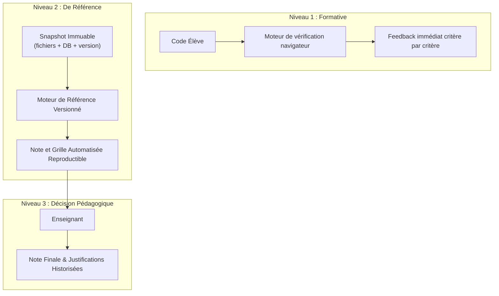

# Architecture Technique — Labo STI

> **Document de référence** : PRD v3.1 (§7, §8, §10, §13)  
> **Dernière révision** : 18 octobre 2026

---

## 1. Vue d'Ensemble du Système

L'architecture de **Labo STI** repose sur un principe d'exécution locale dans le navigateur de l'élève (Client-Side Sandboxing), orchestré par une application fullstack TanStack Start hébergée sur Vercel et adossée à une infrastructure Supabase (PostgreSQL, Authentification, Stockage d'objets, Realtime).

```
┌────────────────────────────────────────────────────────────────────────────────────────┐
│                                   NAVIGATEUR CLIENT                                    │
│                                                                                        │
│  ┌──────────────────────────────────────────────────────────────────────────────────┐  │
│  │                     Interface Utilisateur (TanStack Start / React 19)            │  │
│  │  ┌───────────────┬─────────────────────────────────┬──────────────────────────┐  │  │
│  │  │ Explorateur   │ Éditeur de Code Monaco          │ Panneau d'Exécution      │  │  │
│  │  │ SW_xxxxx/     │ - Coloration multi-langages     │ - Énoncé Markdown        │  │  │
│  │  │ ├ index.html  │ - Raccourcis VS Code            │ - Vérification critères  │  │  │
│  │  │ ├ style.css   │ - Complétion & Lint             │ - Indices progressifs    │  │  │
│  │  │ └ script.js   │ - Sauvegarde auto (< 1s)        │ - Minuteur d'examen      │  │  │
│  │  └───────────────┴─────────────────────────────────┴──────────────────────────┘  │  │
│  └────────────────────────────────────────┬─────────────────────────────────────────┘  │
│                                           │                                            │
│               ┌───────────────────────────┼───────────────────────────┐                │
│               ▼                           ▼                           ▼                │
│  ┌─────────────────────────┐ ┌─────────────────────────┐ ┌─────────────────────────┐  │
│  │      Aperçu Web         │ │    PHP WebAssembly      │ │     SQL Local Engine     │  │
│  │  (iframe sandbox isolée)│ │   (Web Worker dédié)    │ │   (SQLite WASM + Lint)   │  │
│  │  - DOM live             │ │  - PHP 8.2 runtime      │ │  - Schéma relationnel    │  │
│  │  - CSS calculé          │ │  - PDO / mysqli driver  │ │  - Dumps .sql du sujet   │  │
│  │  - Événements JS        │ │  - Limites CPU/RAM/Time │ │  - Contrôle dialecte     │  │
│  └─────────────────────────┘ └─────────────────────────┘ └─────────────────────────┘  │
│               │                           │                           │                │
│               └───────────────────────────┼───────────────────────────┘                │
│                                           ▼                                            │
│  ┌──────────────────────────────────────────────────────────────────────────────────┐  │
│  │           Couche de Résilience Client (Tampon Local & Cache Hors Ligne)          │  │
│  │  - IndexedDB (`labo_sti_buffer`) : écriture locale immédiate, système de `rev`   │  │
│  │  - Service Worker : mise en cache des binaires WASM, bibliothèques et énoncés    │  │
│  │  - Queue de synchronisation en tâche de fond avec résolution de conflits         │  │
│  └────────────────────────────────────────┬─────────────────────────────────────────┘  │
└───────────────────────────────────────────┼────────────────────────────────────────────┘
                                            │ HTTPS / TLS (JWT Auth & RLS)
                                            ▼
┌────────────────────────────────────────────────────────────────────────────────────────┐
│                                   INFRASTRUCTURE SERVEUR                               │
│                                                                                        │
│  ┌──────────────────────────────────────────────────────────────────────────────────┐  │
│  │              Serveur SSR & Fonctions API Sécurisées (Nitro / Vercel Edge)        │  │
│  │  - Gestion du temps officiel des sessions d'examen (horloge serveur étanche)     │  │
│  │  - Distribution sécurisée des indices et validation des solutions                │  │
│  │  - Rejouage de référence pour les examens (Moteur versionné sur snapshot)        │  │
│  └────────────────────────────────────────┬─────────────────────────────────────────┘  │
│                                           │                                            │
│  ┌────────────────────────────────────────┴─────────────────────────────────────────┐  │
│  │                                 Supabase Backend                                 │  │
│  │  ┌───────────────────────┬───────────────────────┬────────────────────────────┐  │  │
│  │  │    Supabase Auth      │   Supabase Postgres   │      Supabase Storage      │  │  │
│  │  │  - Rôles applicatifs  │  - 26 tables typées   │  - Énoncés & Médias        │  │  │
│  │  │  - Protection emails  │  - RLS activée 100%   │  - Dumps SQL & Solutions   │  │  │
│  │  │  - Tokens sécurisés   │  - Triggers immuables │  - Snapshots d'archives    │  │  │
│  │  └───────────────────────┴───────────────────────┴────────────────────────────┘  │  │
│  └──────────────────────────────────────────────────────────────────────────────────┘  │
└────────────────────────────────────────────────────────────────────────────────────────┘
```

---

## 2. Environnements d'Exécution Client

### 2.1 Bac à Sable HTML / CSS / JavaScript
- **Mécanisme** : `iframe` avec attributs stricts : `sandbox="allow-scripts"`.
- **Confinement** :
  - L'attribut `allow-same-origin` est **exclu** pendant l'exécution du code élève pour interdire tout accès au `localStorage`, aux cookies de session ou au DOM de l'application hôte.
  - L'attribut `allow-top-navigation` est **exclu** pour empêcher toute redirection intempestive de la page parente.
  - L'émission de requêtes réseau (`fetch`, `XMLHttpRequest`, `WebSocket`, `EventSource`) est bloquée ou mockée.
- **Ressources statiques** : Les images importées par l'élève dans `Travail_Eleve/` sont converties en `Blob URLs` ou `Data URIs` injectées localement dans l'iframe.

### 2.2 Exécution PHP en WebAssembly (Phase 2)
- **Mécanisme** : Runtime PHP compilé en WebAssembly (ex: `@php-wasm/web` ou équivalent standard), exécuté au sein d'un **Web Worker dédié**.
- **Avantages** : L'exécution s'effectue hors du fil d'exécution principal de l'UI (pas de freeze en cas de boucle infinie).
- **Contrôles de ressources** :
  - **Timeout strict** : interruption forcée du Worker après 3 000 ms.
  - **Limite mémoire** : plafond fixé à 64 Mo par exécution.
  - **Taille de sortie** : troncature des buffers `stdout` à 1 Mo max.
- **Support des fonctionnalités clés** : `GET`/`POST`, variables superglobales `$_SESSION`, parsing de requêtes HTTP simulées, fonctions de hachage et chaînes.

### 2.3 Moteur SQL Local & Contrôleur de Dialecte (Phase 2)
- **Moteur embarqué** : SQLite compilé en WebAssembly.
- **Problématique d'écart de dialecte** :
  Le programme du Bac STI évalue les élèves sur **MySQL / MariaDB**. Or, SQLite possède des comportements permissifs :
  - Autorisation des colonnes non agrégées dans `GROUP BY` (contrairement à MySQL `ONLY_FULL_GROUP_BY`).
  - Typage dynamique souple (insertion de chaînes dans un champ déclaré integer).
  - Syntaxes spécifiques différentes (`AUTOINCREMENT` vs `AUTO_INCREMENT`, concaténation `||` vs `CONCAT()`, fonctions de date `strftime` vs `DATE_FORMAT`).
- **Composant « Contrôleur de Dialecte »** :
  Avant exécution sur SQLite, la requête élève est analysée par un parser SQL (AST) :
  - Détection des constructions non portables MySQL.
  - Émission d'un avertissement pédagogique non bloquant à l'élève :  
    *« Attention : cette requête fonctionne dans votre navigateur mais échouerait sur le serveur d'examen MySQL (ex: fonction CONCAT attendue au lieu de ||). »*

---

## 3. Plan B : Architecture Hybride de Secours (§8.3)

Si la Phase 0 aboutit à un **No-Go** (faisabilité PHP WASM insuffisante, instabilité mémoire ou incompatibilité critique des extensions requises) :

| Dimension | Architecture Standard (Client WASM) | Plan B (Architecture Hybride Isolée) |
|---|---|---|
| **Exécution HTML/CSS/JS** | Navigateur (iframe) | Navigateur (iframe) |
| **Exécution PHP & MySQL** | Client Web Worker WASM + SQLite | Serveur dédié (Conteneurs Docker éphémères) |
| **Fidélité au Bac STI** | Émulation navigateur | 100 % native (vrai PHP 8.2 + MariaDB 10.11) |
| **Infrastructure requise** | Vercel (statique / edge) + Supabase | Cluster de runners conteneurisés (Hetzner / Fly.io / AWS ECS) |
| **Coût par élève** | Négligeable (calcul déporté) | ~0,02 € à 0,05 € par élève/heure |
| **Isolation** | Bac à sable navigateur | Conteneur sans réseau sortant détruit après session |

---

## 4. Stratégie de Persistance et Tampon Local (Offline-First)

Pour garantir l'intégrité absolue du travail de l'élève (principe : **0 perte de données**) :

1. **Tampon IndexedDB (`labo_sti_buffer`)** :
   - Chaque modification dans Monaco est enregistrée en local en < 50 ms.
   - Les documents portent un identifiant de projet, un chemin de fichier et un entier séquentiel `rev`.
2. **Synchronisation Asynchrone vers Supabase** :
   - Un débogueur de synchronisation dépile les modifications locales par batchs toutes les 1 500 ms vers `projet_fichiers`.
   - En cas d'échec de communication (réseau déconnecté, Wi-Fi lycée saturé), la file locale continue d'accumuler les diffs sans bloquer l'élève.
3. **Résolution des Conflits de Révision** :
   - Si `serveur.rev > local.rev` lors d'une tentative de push (ex: projet ouvert simultanément dans deux onglets) :
     - L'application bloque l'écrasement automatique.
     - Une modale comparative affiche le diff et propose : *Conserver ma version locale*, *Remplacer par la version distante*, ou *Sauvegarder une copie de secours*.

---

## 5. Correction Automatique à Trois Niveaux



1. **Niveau Formatif** : Exécuté côté client à l'initiative de l'élève via le bouton « Vérifier ». Permet d'itérer, d'apprendre de ses erreurs et de mesurer sa progression en cours d'exercice.
2. **Niveau De Référence** : Exécuté sur un **Snapshot immuable** d'examen scellé à l'échéance serveur. Rejoue les tests avec la version figée du moteur et des critères.
3. **Niveau Décision Pédagogique** : L'enseignant consulte la grille pré-remplie par la correction de référence, ajuste les points si nécessaire (tolérance, syntaxe alternative valide), commente et attribue la note finale définitive.
